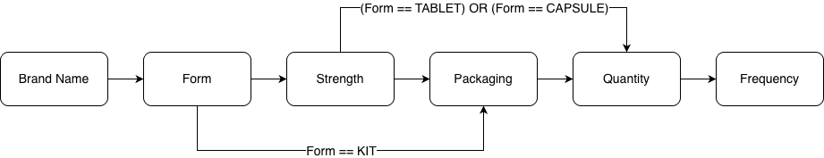

# Medicine Cabinet

A [Kizen](https://kizen.com) CRM plugin that lets agents search the [FDA NDC database](https://open.fda.gov/apis/drug/ndc/) for medications, pharmacies, and providers, and attach them to a contact's record for enrollment quotes.

## Architecture

- **Drug Search** — a multi-step form (`dynamicPrompt`) that narrows an FDA NDC search from brand name → dosage form → dosage strength → packaging → quantity/frequency, then creates or reuses a medication record and links it to the contact's `drugs` field.
- **Add/Remove Pharmacy** and **Add/Remove Provider** — similar record-search-and-link actions for pharmacies and providers.
- A parallel set of automation steps (used in no-code automations rather than manual actions) that look up, validate, and upsert drug/pharmacy/provider references from call summaries, and link the results back to a contact.

### API Integration

**Base URL**: `https://api.fda.gov/drug/ndc.json` ([API Documentation](https://open.fda.gov/apis/drug/ndc/))

The action makes multiple API calls to the FDA database:

1. Initial search by brand name with wildcard matching
2. Secondary call to get complete data for selected brand names
3. All calls filter for `finished:true` and `product_type:PRESCRIPTION`

### Form Steps & NDC Tracking

The form progressively narrows down NDC options at each step. After the initial API calls, each step maintains the current set of NDC records and may terminate early based on dosage form requirements.



1. **Brand Name Search** (`brand_name`)

   - **API Call**: Initial search with brand name wildcard matching
   - Returns aggregated clean names mapped to original brand name arrays
   - Implements intelligent sorting (query matches first, then by length)

2. **Dosage Form** (`dosage_form`)

   - **API Call**: Secondary call with exact brand name matches to get complete dataset
   - **NDC Tracking**: Maintains array of all matching drug records for selected brand(s)
   - Prioritizes tablets, sorts by length
   - Condition: `Boolean({{brand_name}}?.value)`

3. **Dosage Strength** (`dosage_strength`)

   - **NDC Tracking**: Filters NDC records from dosage_form step by active ingredient strength
   - Client-side processing only - no additional API calls
   - Parses strength values, handles multi-ingredient drugs
   - Condition: Enabled except for KIT products
   - Limit: 30 results max

4. **Packaging** (`packaging`) - **Conditional Step**

   - **NDC Tracking**: Processes packaging arrays from previous step's NDC records
   - **Early Termination Logic**:
     - **Skipped for**: TABLET, CAPSULE (packaging irrelevant)
     - **Required for**: Injections, solutions, inhalers, KITs (packaging size/format matters)
   - **Why it matters**: Bottle sizes for solutions, syringe counts for injections, inhaler doses
   - Strips NDC codes from descriptions, filters out sample products
   - Condition: `(dosage_strength exists AND form ≠ TABLET/CAPSULE) OR form = KIT`

5. **Quantity/Frequency**
   - Always required when previous steps complete
   - No NDC filtering - just metadata for final drug record

### Final NDC Selection

At the end of the workflow, the system selects a single packaging NDC from the remaining options. Bias towards steps later in the flow.

```javascript
// NDC selection hierarchy (first available):
const selectedPkgNDCs =
  result.values.packaging?.value || // From packaging step
  extractAndFlattenPackaging(result.values.dosage_strength?.value) || // From strength step
  extractAndFlattenPackaging(result.values.dosage_form?.value) || // From form step
  [];

const finalPkg = getMinNdcByStartDate(selectedPkgNDCs); // Oldest marketing_start_date
```

**Selection Logic**: Takes the packaging NDC with the **oldest** `marketing_start_date` to ensure consistent selection of established products over newer formulations.

## Structure

```
kizen.json                          Plugin manifest: metadata, environments, and service definitions
src/actions/                        Manual contact-record actions (JS, dynamicPrompt-based)
  addPharmacy/, addProvider/        Search and link a pharmacy or provider to a contact
  drugSearch/                       Multi-step drug search and link
  removeDrug/, removePharmacy/,
  removeProvider/                   Unlink a previously added record
src/automationSteps/                Steps usable inside no-code automations (Python)
  lookup{Drug,Pharmacy,Provider}/   Search for a matching record
  upsert{Drug,Pharmacy,Provider}/   Create the record if it doesn't already exist
  add{Drug,Pharmacy,Provider}
    References/                     Link a found/created record to a contact
  validate*Extraction/,
  validateDrugQuantity/             Sanity-check extracted values before lookup
  checkRefsComplete/,
  summarizeFailedLookups/,
  linkContactToCallSummary/         Aggregate and report automation results
releaseNotes/                       Per-version release notes shown in the Kizen plugin marketplace
```

### Data Processing Functions

#### NDC Normalization

```javascript
function normalizeNdc(ndc) {
  // Converts variable format NDCs (####-###-##) to 11-digit format
  // Pads each segment: 5-4-2 digits
}
```


#### Package Selection Logic

```javascript
function getMinNdcByStartDate(packaging) {
  // Selects package with earliest marketing_start_date
  // Used for final NDC determination
}
```


#### Name Cleaning Algorithm

- Generic drugs: Uses active ingredient names when brand name contains generic name
- Brand drugs: Uses brand name directly
- Fallback: Active ingredients or generic name for KITs

### Database Operations

#### Medication Record Management

- **Search**: `/records/medications_medication/search?search=${drugName}`
- **Create**: `/records/medications_medication/add` (only if not exists)
- **Drug Name Format**: `${ndc}-${quantity}-${frequency}`

#### Contact Association

- **Update**: `/records/client_client/${contact.id}`
- **Field**: `drugs` (array of drug name references)
- **Behavior**: Appends to existing drugs, prevents duplicates

### Error Handling

- Form validation through required fields and conditional logic
- API error handling implicit through result checking
- Toast notification for incomplete selections: `"Selection incomplete"`
- Graceful fallbacks for missing data (empty strings, null checks)

### Development Notes

#### Debugging

- Extensive `console.log` statements for each step's results
- JSON.stringify with formatting for complex objects
- State logging shows full selection context

#### Performance Considerations

- Two-stage API calls optimize performance while ensuring complete data retrieval
  - First call returns partial results for brand name selection to avoid over-fetching
  - Second call fetches ALL drug records for selected brand names (not limited by initial search constraints)
- Client-side processing for dosage/packaging reduces API calls
- Typeahead delays API calls until user input
- Result limits (100 for API, 30 for dosage strength)


#### Customization Points

- `registerUtils` provides reusable functions (`getBaseUrl`, `capitalizeWords`)
- Sorting algorithms can be modified for different prioritization
- Frequency options are hardcoded but easily configurable
- API limits and search parameters are adjustable

### Dependencies

- Contact record must have the `drugs` field configured as an array type (and equivalent fields for pharmacies/providers).
- Requires the CRM framework's `dynamicPrompt`, `currentEntity`, `post`, and `patch` methods for the JS actions.
